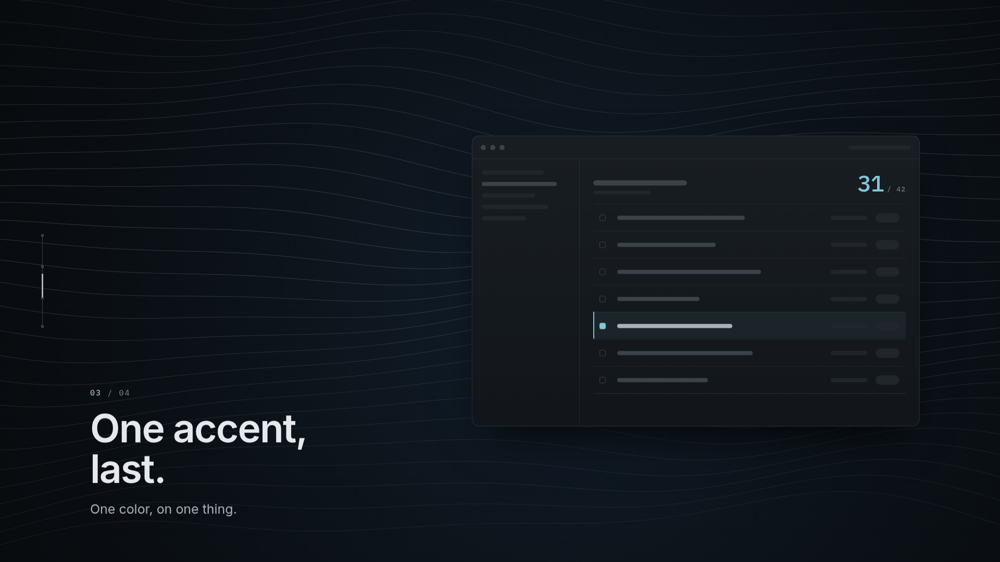

# Scroll study: the product holds still, the page moves around it

A single-page scroll motion study, first made November 22, 2026. Watch the 9-second clip in `water-steel-study-2026-11-22.mp4`, or open `index.html` in a browser and scroll.

## The rules it follows

- **Steel holds.** The product card is pinned and never moves. Its inner state steps rigidly, with no bounce or overshoot.
- **Water moves.** The background lines and tint drift and change shape from chapter to chapter.
- **One accent, last.** A single ice-blue accent arrives at the end and nowhere else.
- **Measured in scroll, not time.** Every change is tied to scroll position, not a timer.
- **If a thumb can outrun it, it never hides content.** On a fast flick, every reveal snaps to its finished, readable state. Motion sits on top of the content; it never decides when you get to read it.

## Files

- `index.html` is the study itself, with no dependencies.
- `record.py` renders the page frame by frame in headless Chromium (Playwright) at 1920x1080 and 60 fps, then encodes H.264 with ffmpeg.
- `stills/` holds three frames from the start, middle and end.

© 2026. All rights reserved. You're welcome to study it and learn from it; please ask before reusing it.
